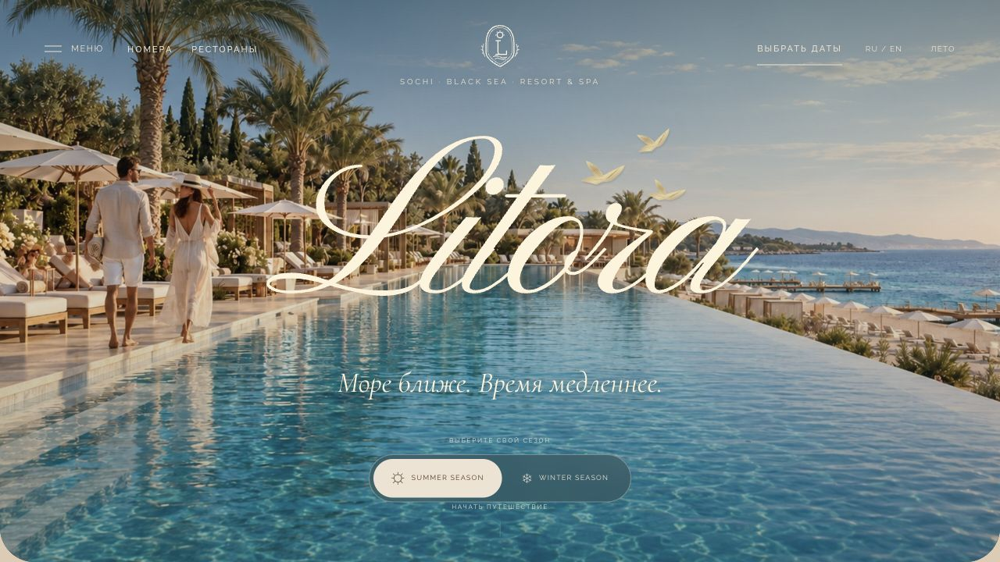

# LITORA Resort & Spa

Портфолио-концепт большого современного курорта в Сочи. Русский и английский языки, летнее и зимнее настроение, 52 страницы и 202 созданные для проекта фотографии.



Шесть категорий номеров, пять бассейнов, восемь термальных пространств, три ресторана, четыре бара, пляж, гольф и программы отдыха. Скролл-сцены, плавные фотогалереи, интерактивная карта и доступный режим уменьшенного движения.

Отель вымышленный. Бронирование и подписка демонстрационные: заявки, данные гостей и платежи не отправляются. Фото и два шестисекундных сезонных ролика созданы генеративными моделями.

## Локальный просмотр

Нужен Node.js 22 или новее.

```sh
npm ci
npm run preview
```

Открыть http://127.0.0.1:4173. После перезагрузки компьютера запустить просмотр снова.

## Проверка перед публикацией

```sh
npx playwright install chromium
npm run check
```

`npm test` запускает проверки логики. `npm run test:e2e` запускает Playwright на настольном и мобильном экранах. Команда сама собирает сайт и временно запускает его на отдельном адресе под `/litora-resort/`, чтобы проверить условия GitHub Pages. Рабочий локальный просмотр не останавливается.

```sh
npm run test:e2e:ui      # интерактивный запуск
npm run test:e2e:report  # сохранённый HTML-отчёт
```

## Сборка и GitHub Pages

```sh
npm run build
```

Для вложенного адреса задать `LITORA_BASE_PATH=/имя-репозитория`. При размещении на корне домена оставить переменную пустой. Сборка сохраняется в `dist/`; эта папка не добавляется в Git.

Публикация выполняется командой `npm run publish:pages`: сначала логика и Playwright, затем проверенная сборка отправляется в ветку `gh-pages`. Для этого не требуется разрешение GitHub OAuth `workflow`. Подробности: [DEPLOYMENT.md](DEPLOYMENT.md).

## Исходники

Обычные HTML, CSS и JavaScript-модули; серверная база данных не требуется. ScrollCraft управляет сценами прокрутки, Web Animations API переключает кадры. Используются локальные шрифты и оптимизированные изображения. Репозиторий содержит принятые материалы; отклонённые фото, исходные PNG, локальные журналы и отчёты остаются за его пределами.
